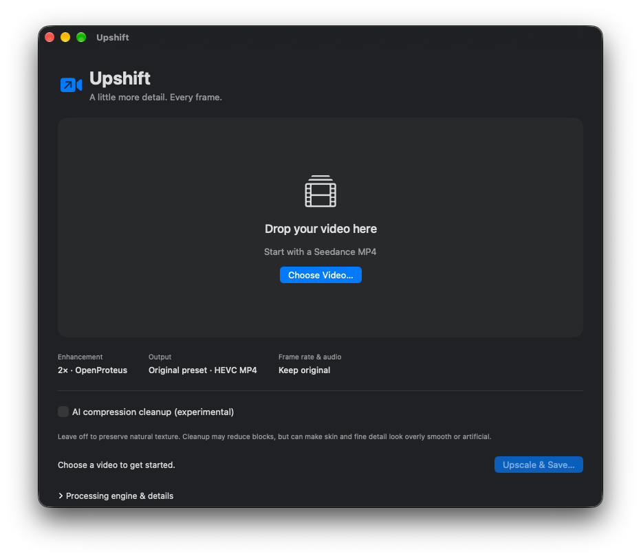

# Upshift

> **Mac App Store preparation branch:** sandbox prototype in progress.
> Start with [App Store readiness](AppStore/READINESS.md); this branch is not ready for submission.

Upshift is a native macOS app that uses AI models to upscale videos to 2× resolution.
Built with SwiftUI, it offers Apple silicon acceleration, HEVC MP4 output, and
preserved frame rates and audio through a simple interface. Processing stays on your Mac.

## Download

Download **UpShift-1.0.1-macOS-arm64.zip** from the
[1.0.1 release](https://github.com/mingistech/UpShift/releases/tag/v1.0.1), unzip it,
and move **UpShift.app** to Applications. The release includes its processing
engine and models; Python, Homebrew, and separate model downloads are not needed.

Requires an **Apple silicon Mac**. The SwiftUI frontend targets macOS 14 or later;
the bundled runtime is validated on the development Mac, not every supported OS version.

## Use

Drop a video into the window, or choose **Choose Video…**, then **Upscale & Save…**.
Choose a destination and wait for the completed export. The app displays the saved
path and offers **Show in Finder**. It remembers the last completed export.

- OpenProteus Compact 2× AI upscaling on the Apple GPU.
- Original compact HEVC VideoToolbox preset: quality 65, 8-bit SDR MP4.
- Original constant frame rate and compatible audio tracks preserved.
- Progress, cancellation, and verification before replacing an existing output.

Version 1.0.1 supports SDR, constant-frame-rate video with one video track. HDR,
variable frame rates, and rotation metadata are rejected with an explanation.
Subtitles are omitted. Audio must be AAC, MP3, ALAC, AC-3, or E-AC-3 for MP4 copying.
Upscaling cannot guarantee recovery of detail absent from the source.

**Model license:** the bundled OpenProteus model is CC BY-NC 4.0 and carries a
noncommercial restriction. See [third-party notices](UpShift/Resources/THIRD_PARTY_NOTICES.md)
for attribution, licenses, and source references.

## Build this App Store branch

Run `Scripts/setup-engine.sh` to install the development engine, then follow
[App Store readiness](AppStore/READINESS.md) and run `Scripts/prepare-app-store.sh`.
The resulting local preview is sandboxed and self-contained. Its container is
separate from the published direct-download app. Opening this project in Xcode
builds the frontend; engine packaging/signing is performed by the preparation script.

The backend is pinned to RVE commit `8541c46ca14e6f84fc86c5b9d3b75373e25732e5`;
dependencies and model checksums remain pinned. Model and engine distribution
rights still need resolution for the App Store. See the readiness document.

[Validation results](AppStore/VALIDATION.md) record actual signed-sandbox tests.
[Listing draft](AppStore/METADATA.md) and [privacy-policy draft](AppStore/PRIVACY.md)
are prepared for review. No App Store submission has been made.
